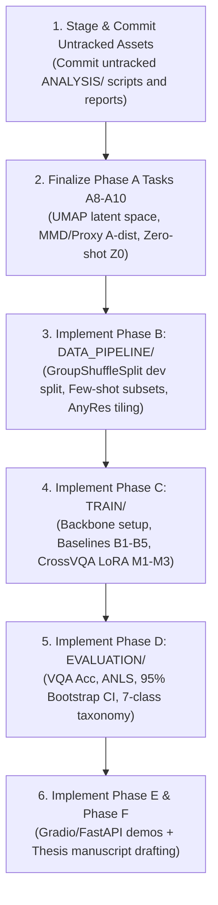

# CrossVQA: Project Progress Reassessment & Milestone Status Report

* **Date:** 2026-10-17 (Local Time: 18:27:00+07:00)
* **Author:** Tung Tran
* **Institution:** Posts and Telecommunications Institute of Technology (PTIT), Hanoi, Vietnam
* **Faculty:** Faculty of Information Technology
* **Project Repository:** `NhanChanDeo/VQA_Final_Thesis`
* **Governing Rules & Specifications:** [`.agents/rules/prompt-output-to-markdown.md`](.agents/rules/prompt-output-to-markdown.md)
* **Master Reference Plans:**
  * [`PLAN/12-08-00_2026-10-09_(EN)_CrossVQA_Lossless_Branch_Inspection_and_Thesis_Execution_Plan.md`](PLAN/12-08-00_2026-10-09_(EN)_CrossVQA_Lossless_Branch_Inspection_and_Thesis_Execution_Plan.md)
  * [`PLAN/11-30-00_2026-10-09_CrossVQA_Lossless_Branch_Inspection_and_Thesis_Execution_Plan.md`](PLAN/11-30-00_2026-10-09_CrossVQA_Lossless_Branch_Inspection_and_Thesis_Execution_Plan.md)
  * [`PLAN/Colab_DocVQA_TextVQA_Analysis_Plan.md`](PLAN/Colab_DocVQA_TextVQA_Analysis_Plan.md)
  * [`PLAN/ThesisPremise.md`](PLAN/ThesisPremise.md)
  * [`README.md`](README.md)

---

## 1. Executive Summary & Status Dashboard

This document compiles the exhaustive progress audit and reassessment of the **CrossVQA** graduation research project (*Cross-Domain Knowledge Transfer from Document Images to Natural Scene Images for Vision-Language Models*). 

The reassessment categorizes all technical components across the six thesis engineering phases into three strict categories:
1. **DONE (100% Complete):** Data ingestion, lossless engineering, schema standardization, and dual-branch Hugging Face Hub publication.
2. **IN PROGRESS (~25% – 70% Complete):** Exploratory data analysis (EDA), dataset profiling, interactive Colab analysis execution, and thesis foundation chapters.
3. **NOT TOUCHED (0% Complete):** Data pipeline engineering, model training/LoRA adapter baselines, formal post-training evaluation & error taxonomy, and production deployment demos.

### Overall Phase Status Matrix

| Phase / Workstream | Academic Scope | Status | Completion % | Artifacts / Locations |
| :--- | :--- | :---: | :---: | :--- |
| **Milestones 0–4** | Data collection, lossless PNG/JPEG engineering, 15-column canonical schema, streaming sharding, Hub publishing, and Step 10 server-side mirror. | **DONE** | **100%** | [`DATASETS UPLOAD/`](DATASETS%20UPLOAD/)<br>[`DATASETS SCHEMA NORMALIZATION/`](DATASETS%20SCHEMA%20NORMALIZATION/)<br>Hugging Face: `gamusa/docvqa-canonical`, `gamusa/textvqa-canonical` |
| **Phase A** | Exploratory Data Analysis (EDA), distribution profiling, leakage audits, extractive ceilings, and Colab visual reports. | **IN PROGRESS** | **~70%** | [`ANALYSIS/`](ANALYSIS/)<br>[`ANALYSIS/reports/`](ANALYSIS/reports/)<br>`ANALYSIS/*.ipynb` (executed on remote) |
| **Phase B** | Data Pipeline Engineering: Leakage-free grouped splitting, dynamic high-resolution patch tiling (AnyRes), soft targets, and GPU DataLoaders. | **NOT TOUCHED** | **0%** | [`DATA_PIPELINE/`](DATA_PIPELINE/) (contains only `.gitkeep`) |
| **Phase C** | Model Training: Frozen zero-shot Z0, baselines B1–B5, and proposed CrossVQA architecture (Domain-Specific LoRA adapters + Feature Alignment). | **NOT TOUCHED** | **0%** | [`TRAIN/`](TRAIN/) (contains only `.gitkeep`) |
| **Phase D** | Post-Training Evaluation: Multi-metric benchmarking (VQA Acc, ANLS), 95% bootstrap confidence intervals, and 7-class failure taxonomy. | **NOT TOUCHED** | **0%** | [`EVALUATION/`](EVALUATION/) (contains only `.gitkeep`) |
| **Phase E** | System Deployment: Interactive Gradio Web Demo (Vector E1), quantized FastAPI REST API (Vector E2), domain router, and drift monitor. | **NOT TOUCHED** | **0%** | [`DEMO/`](DEMO/) (contains only `.gitkeep`) |
| **Phase F** | Thesis Dissertation: 5-chapter PTIT thesis manuscript, literature bibliography, and automated table generation. | **IN PROGRESS** | **~25%** | [`PLAN/`](PLAN/) (Premise, literature review, execution plans done; manuscript chapters pending) |

---

## 2. Completed Components (DONE — 100%)

### 2.1 Raw Dataset Ingestion (Milestone 0 / Steps 1–5)
* **DocVQA Task 1 Ingestion:** Retrieved, extracted, and structured high-resolution scanned documents (UCSF industry archives) and OCR tokens via [`DATASETS UPLOAD/Step2_3(1)_Fetch_Extract_DocVQA.ipynb`](DATASETS%20UPLOAD/Step2_3(1)_Fetch_Extract_DocVQA.ipynb) and [`DATASETS UPLOAD/Step2_3_Fetch_Upload_DocVQA.ipynb`](DATASETS%20UPLOAD/Step2_3_Fetch_Upload_DocVQA.ipynb).
* **TextVQA v0.5.1 Ingestion:** Ingested natural scene images from OpenImages coupled with Rosetta OCR bounding boxes via [`DATASETS UPLOAD/Step4_5_Fetch_Upload_TextVQA.ipynb`](DATASETS%20UPLOAD/Step4_5_Fetch_Upload_TextVQA.ipynb).
* **Repository Bootstrapping:** Initialized Hugging Face repositories via [`DATASETS UPLOAD/Step1_Create_HF_Repos.ipynb`](DATASETS%20UPLOAD/Step1_Create_HF_Repos.ipynb).

### 2.2 Canonical Schema Normalization (Milestone 1)
Implemented in [`DATASETS SCHEMA NORMALIZATION/canonical_schema.py`](DATASETS%20SCHEMA%20NORMALIZATION/canonical_schema.py), unifying all heterogeneous column names into a 15-column canonical specification:
```text
├── sample_id        : string (Unique identifier, e.g., 'textvqa_34602', 'docvqa_49153')
├── domain_type      : string ('scene_text' | 'document_text')
├── question_id      : string
├── question         : string
├── image            : struct {'bytes': binary, 'path': null} (Directly decodable via PIL)
├── image_format     : string ('PNG' | 'JPEG')
├── image_width      : int32
├── image_height     : int32
├── answers          : list<string> (Full list of ground-truth annotations)
├── canonical_answer : string (Normalized majority-vote answer)
├── ocr_tokens       : list<string> (Rosetta OCR for TextVQA, MS Azure for DocVQA)
├── ocr_boxes        : list<list<float32>> ([ymin, xmin, ymax, xmax] normalized to [0, 1000])
├── source_dataset   : string ('textvqa' | 'docvqa')
├── original_split   : string ('train' | 'validation' | 'test')
└── metadata         : string (Serialized JSON containing dataset-specific auxiliary fields)
```

### 2.3 Lossless Engineering & Parquet Sharding (Milestones 2–3 / Steps 6–9)
* **True Lossless PNG for DocVQA:** Completely eliminated generational JPEG compression ringing around small text and table rules, preserving original PNG byte streams intact.
* **Native JPEG Bit-for-Bit for TextVQA:** Retained original JPEG byte streams for upright images; applied `ImageOps.exif_transpose` and maximum-quality encoding (`quality=100, subsampling=0` 4:4:4) for rotated images to maintain spatial alignment with OCR bounding boxes.
* **PyArrow Streaming Sharding:** Exported with `write_page_index=True`, enabling sub-second random seeking:
  * DocVQA: 50 train shards (800 samples/shard, ~150–350 MB/shard).
  * TextVQA: 14 train shards (2,500 samples/shard, ~350–500 MB/shard).

### 2.4 Modernization & Dual-Branch Hub Architecture (Milestone 4 / Step 10)
Executed via [`DATASETS SCHEMA NORMALIZATION/Step10_Mirror_Lossless_To_Main_Without_Test.ipynb`](DATASETS%20SCHEMA%20NORMALIZATION/Step10_Mirror_Lossless_To_Main_Without_Test.ipynb):

| Technical Dimension | Archival Benchmark (`branch: lossless`) | Curated Experimental Benchmark (`branch: main`) | Academic Rationale |
| :--- | :--- | :--- | :--- |
| **TextVQA Hub Link** | [`gamusa/textvqa-canonical` (`lossless`)](https://huggingface.co/datasets/gamusa/textvqa-canonical/tree/lossless) | [`gamusa/textvqa-canonical` (`main`)](https://huggingface.co/datasets/gamusa/textvqa-canonical) | Pinned commit `d1dcf73eda54e82e84f69d0265f3a9e663420583` on `main` |
| **DocVQA Hub Link** | [`gamusa/docvqa-canonical` (`lossless`)](https://huggingface.co/datasets/gamusa/docvqa-canonical/tree/lossless) | [`gamusa/docvqa-canonical` (`main`)](https://huggingface.co/datasets/gamusa/docvqa-canonical) | Pinned commit `86e379d727ab104301e3639b909bfbddb0af6376` on `main` |
| **Split Coverage** | 3 splits: `train`, `validation`, `test` | 2 splits: `train`, `validation` (**blind test pruned**) | Eliminated empty-label test split (`answers = []`) |
| **TextVQA Footprint** | 19 shards (7.54 GB) \| 45,336 samples | 16 shards (6.64 GB) \| 39,602 samples | Saved 0.90 GB |
| **DocVQA Footprint** | 64 shards (9.46 GB) \| 50,000 samples | 57 shards (8.35 GB) \| 44,812 samples | Saved 1.11 GB |
| **Combined Size** | **17.00 GB** (95,336 samples) | **14.99 GB** (84,414 samples) | **Net 2.01 GB reduction**; zero leakage |

### 2.5 Dataset-Agnostic Statistical Profiler
* Ingestion profiling tool [`ANALYSIS/hf_dataset_analyzer.py`](ANALYSIS/hf_dataset_analyzer.py) complete.
* Generated JSON and Markdown profiling reports in [`ANALYSIS/reports/`](ANALYSIS/reports/):
  * [`ANALYSIS/reports/gamusa__docvqa-canonical.md`](ANALYSIS/reports/gamusa__docvqa-canonical.md)
  * [`ANALYSIS/reports/gamusa__docvqa-canonical.json`](ANALYSIS/reports/gamusa__docvqa-canonical.json)
  * [`ANALYSIS/reports/gamusa__textvqa-canonical.md`](ANALYSIS/reports/gamusa__textvqa-canonical.md)
  * [`ANALYSIS/reports/gamusa__textvqa-canonical.json`](ANALYSIS/reports/gamusa__textvqa-canonical.json)

---

## 3. In-Progress Components (IN PROGRESS — ~25% to 70%)

### 3.1 Phase A: Exploratory Data Analysis (EDA) (~70% Complete)
* **Completed Work:**
  * Created Python notebook compiler [`ANALYSIS/build_colab_notebooks.py`](ANALYSIS/build_colab_notebooks.py).
  * Developed three self-contained Colab notebooks matching the 5-phase structure (Preflight, Fetch, Investigation, Aggregation, Visualization, Evaluation):
    1. [`ANALYSIS/DocVQA_Analysis.ipynb`](ANALYSIS/DocVQA_Analysis.ipynb) (40 cells)
    2. [`ANALYSIS/TextVQA_Analysis.ipynb`](ANALYSIS/TextVQA_Analysis.ipynb) (40 cells)
    3. [`ANALYSIS/CrossVQA_Comparative.ipynb`](ANALYSIS/CrossVQA_Comparative.ipynb) (33 cells)
  * Executed the three notebooks on Google Colab (committed on `origin/main` via commits `8de5f00`, `e075a4a`, `8f99320`), populating:
    * Resolution & aspect ratio divergence ($4.8\times$ resolution gap; DocVQA ~3.7 MP vs. TextVQA ~0.78 MP).
    * OCR token density distributions ($15\times$ word density divergence; DocVQA median 159 words vs. TextVQA median 8 words).
    * OCR spatial layout heatmaps (uniform grid for DocVQA vs. center-weighted cluster for TextVQA).
    * Extractive answer ceiling calculations (exact match and soft ANLS match).
    * Cross-split leakage checks across `image_id`, `question`, and answers.
    * Data Health Index (DHI) evaluations.
* **Remaining Phase A Tasks (Tasks A8 – A10):**
  * **Task A8 (Multimodal Latent Space UMAP):** Extract multimodal representations via frozen ViT + LLM encoders; project to 2D UMAP to visualize cluster separation between `scene_text` and `document_text`.
  * **Task A9 (Quantitative Distribution Discrepancy):** Compute reproducing kernel Hilbert space Maximum Mean Discrepancy (MMD) and train a linear domain classifier to measure Proxy $\mathcal{A}$-distance ($\hat{d}_{\mathcal{A}} = 2(1 - 2\epsilon)$).
  * **Task A10 (Zero-Shot Backbone Benchmark Z0):** Run zero-shot evaluation on the frozen base VLM across validation splits to establish the unadapted performance floor and audit pre-training contamination.

### 3.2 Phase F: Thesis Architecture & Academic Manuscript (~25% Complete)
* **Completed Work:**
  * Defined foundational thesis premise and theoretical framework in [`PLAN/ThesisPremise.md`](PLAN/ThesisPremise.md).
  * Curated 40+ academic literature references across VQA, PEFT, and Domain Adaptation in [`PLAN/Papers_List.md`](PLAN/Papers_List.md).
  * Structured master execution plan aligned with the official PTIT 5-Chapter Graduation Thesis structure in [`PLAN/12-08-00_2026-10-09_(EN)_CrossVQA_Lossless_Branch_Inspection_and_Thesis_Execution_Plan.md`](PLAN/12-08-00_2026-10-09_(EN)_CrossVQA_Lossless_Branch_Inspection_and_Thesis_Execution_Plan.md).
* **Remaining Phase F Tasks:**
  * Write Chapter 1 (Introduction & Research Questions).
  * Write Chapter 2 (Literature Review, Theoretical Foundations & Empirical EDA Reports).
  * Write Chapter 3 (Proposed CrossVQA Methodology & Architecture).
  * Write Chapter 4 (Experimental Results, Baseline Comparisons, and Error Analysis).
  * Write Chapter 5 (Conclusion, Deployment Vectors, and Future Research).
  * Implement `scripts/export_thesis_tables.py` for automated programmatic export of `metrics.json` directly into LaTeX/Markdown tables.

---

## 4. Untouched Components (NOT TOUCHED — 0%)

The technical core of the thesis training, evaluation, and deployment remains untouched. All corresponding workspace directories currently contain only `.gitkeep` placeholders.

```text
├── DATA_PIPELINE/     [0% - Empty placeholder]
├── TRAIN/             [0% - Empty placeholder]
├── EVALUATION/        [0% - Empty placeholder]
└── DEMO/              [0% - Empty placeholder]
```

### 4.1 Phase B: Data Pipeline & DataLoader Engineering ([`DATA_PIPELINE/`](DATA_PIPELINE/))
* **Task B1 (Grouped Leakage-Free Splitting):**
  * Implement `GroupShuffleSplit` on `ucsf_document_id` (from DocVQA `metadata`) to ensure multi-page documents never span train and dev.
  * Implement `GroupShuffleSplit` on `image_id` for TextVQA.
  * Carve out a reproducible 5% internal `dev` split, saving sampled IDs to `results/splits/dev_sample_ids.json` with SHA-256 integrity verification.
* **Task B2 (Few-Shot Target Stratification):**
  * Generate nested stratified subsets from TextVQA-train: 1% (346 samples), 5% (1,730 samples), 10% (3,460 samples), 25% (8,650 samples), and 100% (32,872 clean samples) to evaluate Hypothesis H4.
* **Task B3 (Dynamic High-Resolution Tiling - AnyRes):**
  * Implement adaptive patch partitioning ($N \le 4$ patches of $384 \times 384$ px + thumbnail overview) for high-resolution DocVQA PNGs.
  * Implement spatial coordinate re-scaling to preserve OCR bounding box fidelity.
* **Task B4 (Target Normalization & Soft Targets):**
  * Compute soft cross-entropy targets based on annotator vote frequencies:
    $$p_{\text{target}}(y) = \frac{\text{Count}(y \in \text{answers})}{10}$$
* **Task B5 (Streaming PyTorch DataLoader):**
  * Implement multi-worker streaming DataLoader with sequence length bucketing to eliminate padding overhead.

### 4.2 Phase C: Model Architecture & Cross-Domain Training ([`TRAIN/`](TRAIN/))
* **Backbone Infrastructure:**
  * Configure base VLM backbone: **Qwen2-VL-2B (Base)** or **SmolVLM-500M / SmolVLM-2B**.
  * Integrate 16-bit LoRA / 4-bit QLoRA to fit 16–24 GB VRAM budgets.
* **Execution of Baselines (6 Configurations):**
  * **Z0:** Frozen Zero-shot anchor (no fine-tuning).
  * **B1 (Target-only):** Fine-tuned strictly on TextVQA (isolated upper bound).
  * **B2 (Source-only):** Fine-tuned strictly on DocVQA (out-of-domain transfer test).
  * **B3 (Joint Training):** Trained simultaneously on DocVQA + TextVQA (negative transfer audit).
  * **B4 (Sequential):** DocVQA $\rightarrow$ TextVQA (catastrophic forgetting baseline).
  * **B5 (Reverse Sequential):** TextVQA $\rightarrow$ DocVQA (directional asymmetry test).
* **Proposed CrossVQA Architecture (3 Configurations):**
  * **M1:** Domain-Specific LoRA Adapters ($\mathcal{A}_{\text{doc}}$ and $\mathcal{A}_{\text{scene}}$) with soft gating router.
  * **M2:** M1 + Cross-Domain Feature Alignment Objective (InfoNCE / Contrastive / MMD loss).
  * **M3:** M2 + Curriculum pseudo-domains (homography projections with synthetic noise).
* **Few-Shot Matrix:** Re-train B1, B4, and M2 across $\{1\%, 5\%, 10\%, 25\%\}$ target regimes.
* **Statistical Repetition:** Execute 3 random seeds ($42, 123, 999$) for all primary configurations.

### 4.3 Phase D: Post-Training Evaluation & Error Analysis ([`EVALUATION/`](EVALUATION/))
* **Metric Computation Suite:**
  * Implement TextVQA standard: VQA Accuracy ($\min(\sum \mathbb{I} / 3, 1.0)$).
  * Implement DocVQA standard: Average Normalized Levenshtein Similarity (ANLS).
  * Cross-domain evaluation: ANLS on TextVQA, VQA Accuracy on DocVQA.
  * Transfer Gain ($\text{TG} = \text{Acc}_{\text{M2}} - \text{Acc}_{\text{B1}}$) and Forgetting Rate ($\text{FR} = \text{ANLS}_{\text{B2}} - \text{ANLS}_{\text{M2}}$).
* **Statistical Significance Testing:**
  * 95% Bootstrap Confidence Intervals ($B = 1,000$ iterations).
  * Paired permutation hypothesis testing ($p < 0.05$).
* **7-Class Failure Taxonomy Analysis:**
  * Classify $\ge 200$ failure samples across:
    * **E1:** Optical / Recognition blurring artifacts.
    * **E2:** Scene-object context reasoning confusion.
    * **E3:** Spatial layout / tabular grid traversal errors.
    * **E4:** Formatting / casing / lexical normalization mismatch.
    * **E5:** Upstream OCR ceiling omissions.
    * **E6:** Ground-truth ambiguity / conflicting annotations.
    * **E7:** Token truncation / spatial downsampling limit.

### 4.4 Phase E: Real-World System Deployment ([`DEMO/`](DEMO/))
* **Vector E1 (Interactive Gradio Demo):** Web application for Hugging Face Spaces supporting arbitrary user image upload, visual question answering, and attention map visualization.
* **Vector E2 (Production REST API):** Containerized FastAPI backend in Docker with 4-bit quantization and $p95 < 500\text{ms}$ latency.
* **Vector E3 (Automatic Domain Router):** Lightweight visual classifier (MobileNetV4) routing images automatically to $\mathcal{A}_{\text{doc}}$ or $\mathcal{A}_{\text{scene}}$.
* **Vector E4 (Distribution Drift Monitor):** Real-time Proxy $\mathcal{A}$-distance / MMD streaming drift tracker.

---

## 5. Git Status & Synchronization Discrepancies

* **Commit & Branch State:** Local branch `main` is at commit `c477466` (`update progress`) and is **up to date with `origin/main`**.
* **Integrated Remote Results:** Colab notebook runs (`8de5f00`, `e075a4a`, `8f99320`) have been successfully merged into the local workspace.
* **Working Tree State:**
  * **Modified (Unstaged):** `.gitignore`
  * **Untracked Analysis Assets:**
    * [`ANALYSIS/README.md`](ANALYSIS/README.md), [`ANALYSIS/build_colab_notebooks.py`](ANALYSIS/build_colab_notebooks.py), [`ANALYSIS/colab_vqa_analysis_plan.md`](ANALYSIS/colab_vqa_analysis_plan.md), [`ANALYSIS/hf_dataset_analyzer.py`](ANALYSIS/hf_dataset_analyzer.py), [`ANALYSIS/reports/`](ANALYSIS/reports/)
  * **Untracked Planning Documents:**
    * [`PLAN/01-05-00_2026-10-05_CrossVQA_Normalization_Pipeline.md`](PLAN/01-05-00_2026-10-05_CrossVQA_Normalization_Pipeline.md)
    * [`PLAN/02-15-00_2026-10-05_Data_Schema_Discrepancies_and_Handling_Strategies.md`](PLAN/02-15-00_2026-10-05_Data_Schema_Discrepancies_and_Handling_Strategies.md)
    * [`PLAN/06-31-00_2026-10-09_CrossVQA_Inspection_and_Thesis_Execution_Plan.md`](PLAN/06-31-00_2026-10-09_CrossVQA_Inspection_and_Thesis_Execution_Plan.md)
    * [`PLAN/Colab_DocVQA_TextVQA_Analysis_Plan.md`](PLAN/Colab_DocVQA_TextVQA_Analysis_Plan.md)

---

## 6. Actionable Next Steps & Execution Order



1. **Commit Local Artifacts:** Stage and commit the untracked `ANALYSIS/` profiling tools, reports, and `.gitignore` to maintain complete reproducibility.
2. **Execute Phase A Diagnostic Tasks (A8–A10):**
   * **Task A8:** Multimodal latent space UMAP projection (ViT + LLM embeddings).
   * **Task A9:** Compute MMD and Proxy $\mathcal{A}$-distance domain discrepancy.
   * **Task A10:** Benchmark Zero-shot base model floor ($Z_0$).
3. **Begin Phase B Pipeline Engineering:** Implement `grouped_split.py`, few-shot stratification subsets, and PyTorch streaming DataLoaders in [`DATA_PIPELINE/`](DATA_PIPELINE/).
4. **Draft Chapter 2 of Thesis:** Populate Chapter 2 with empirical figures and statistics obtained from the executed Colab comparative reports.
