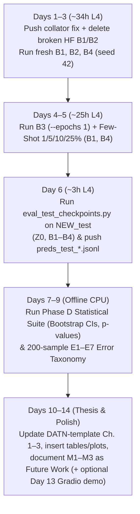

# CrossVQA: Project Progress Reassessment & Milestone Status Report

* **Original Audit:** 2026-10-17 (18:27+07:00)
* **Revised:** 2026-11-27 (09:45+07:00) — Locked `ALT_THREE_SPLITS` dataset & 2-week training-to-defense triage
* **Author:** Tung Tran
* **Institution:** Posts and Telecommunications Institute of Technology (PTIT), Hanoi, Vietnam
* **Faculty:** Faculty of Information Technology
* **Project Repository:** `NhanChanDeo/VQA_Final_Thesis`
* **Master Revised 2-Week Plan:** [`PLAN/2026-11-27_CrossVQA_2Week_Training_to_Defense_Plan.md`](PLAN/2026-11-27_CrossVQA_2Week_Training_to_Defense_Plan.md)
* **Training Pipeline Spec:** [`TRAIN/0805_22112026_CrossVQA_Training_Pipeline_Documentation.md`](TRAIN/0805_22112026_CrossVQA_Training_Pipeline_Documentation.md)
* **Thesis Template Audit:** [`2026-11-25_0413_CrossVQA_DATN_Template_Review_and_Plan.md`](2026-11-25_0413_CrossVQA_DATN_Template_Review_and_Plan.md)

---

## 1. Executive Summary & Live Status Dashboard (As of 2026-11-27)

With data normalization, exploratory data analysis, leakage-free splitting (`ALT_THREE_SPLITS`), and frozen zero-shot/domain-gap quantification (`Z0`) **100% locked in**, the remaining 14-day window focuses strictly on executing **Phase C (core baselines `B1–B4` + few-shot matrix)**, **Phase D (held-out `test` evaluation, 95% Bootstrap CIs, paired permutation tests, 7-class error taxonomy)**, and **Phase F (thesis manuscript completion)**.

To guarantee completion within ~62 Colab L4 GPU-hours, **`M1–M3` (`DualLoRA`, `RBF-MMD`, `Curriculum`) are cut from mandatory 2-week training runs** and retained in `TRAIN/src/{adapters,losses,augmentations}.py` as an *Implemented Architectural Prototype / Future Work*, with Hypothesis **H5** reframed around **Joint Multi-Domain LoRA (`B3`) vs. Sequential Transfer (`B4`)**.

### Overall Phase Status Matrix

| Phase / Workstream | Technical Scope | Status | Completion % | Verified Artifacts / Notes |
| :--- | :--- | :---: | :---: | :--- |
| **Milestones 0–4** | Data ingestion, lossless PNG/JPEG engineering, 15-col schema, sharding, `main` / `lossless` / `three-splits` HF Hub branches | **DONE** | **100%** | [`DATASETS UPLOAD/`](DATASETS%20UPLOAD/), [`DATASETS SCHEMA NORMALIZATION/`](DATASETS%20SCHEMA%20NORMALIZATION/), `gamusa/{docvqa,textvqa}-canonical` |
| **Phase A** | EDA notebooks (`DocVQA`, `TextVQA`, `CrossVQA`), DHI profiling, Tasks A8–A10 (`Z0` + UMAP + MMD + Proxy $\mathcal{A}$-dist) | **DONE** | **100%** | [`ANALYSIS/`](ANALYSIS/), [`TRAIN/ALT_THREE_SPLITS/runs/smolvlm_500m/Z0/`](TRAIN/ALT_THREE_SPLITS/runs/smolvlm_500m/Z0/), [`TRAIN/ALT_THREE_SPLITS/runs/qwen2_vl_2b/Z0/`](TRAIN/ALT_THREE_SPLITS/runs/qwen2_vl_2b/Z0/) |
| **Phase B** | Pooled leakage-free 3-way split (`ALT_THREE_SPLITS`), 523 bridge-doc resolution, 64-bit `pHash` + DSU audit (`10/10` pass), nested few-shot manifest | **DONE** | **100%** | [`DATA_PIPELINE/ALT_THREE_SPLITS/`](DATA_PIPELINE/ALT_THREE_SPLITS/), `crossvqa_split_manifest_pooled.parquet`, `textvqa_few_shot_manifest.parquet` |
| **Phase C** | Core training library (`TRAIN/src/`), `25/25` unit tests, Colab notebooks (`00..05`), `Z0` runs complete; `B1–B4` + Few-Shot queued post-EOS fix | **IN PROGRESS** | **Code 100% / Exec ~15%** | [`TRAIN/`](TRAIN/); `collator.py` EOS masking fixed 2026-11-27 (`B1`/`B2` must re-run fresh) |
| **Phase D** | Held-out `test` evaluation, 95% Bootstrap CIs ($B=1,000$), paired permutation tests ($p<0.05$), and 200-sample `E1–E7` error taxonomy | **READY TO RUN** | **Scripts Ready / Exec 0%** | [`EVALUATION/ALT_THREE_SPLITS/`](EVALUATION/ALT_THREE_SPLITS/), [`TRAIN/ALT_THREE_SPLITS/scripts/eval_test_checkpoints.py`](TRAIN/ALT_THREE_SPLITS/scripts/eval_test_checkpoints.py) |
| **Phase E** | Lightweight interactive Gradio demo (`DEMO/`) | **OPTIONAL / DEFERRED** | **0%** | [`DEMO/`](DEMO/) — only build on Day 13 if Phase D + manuscript are finished |
| **Phase F** | Thesis premise, 40+ papers bibliography, PTIT 3-chapter template audit complete; manuscript drafting underway | **IN PROGRESS** | **~30%** | [`PLAN/`](PLAN/), [`2026-11-25_0413_CrossVQA_DATN_Template_Review_and_Plan.md`](2026-11-25_0413_CrossVQA_DATN_Template_Review_and_Plan.md) |

---

## 2. Completed Foundations & Verified Empirical Numbers

### 2.1 Canonical Benchmarks & Leakage-Free Splits (`Milestones 0–4`, `Phase B`)
- **Hugging Face `three-splits` (`ALT_THREE_SPLITS`):** 84,414 labelled queries across DocVQA (`44,812`: True Lossless PNG + MS Azure OCR) and TextVQA (`39,602`: Native JPEG + Rosetta OCR).
- **Zero-Leakage Resolution:** Eliminated **523 parent documents (`ucsf_document_id`, 13,798 queries)** spanning the original DocVQA `train`/`validation` split, pinned 66–81 mega-doc outliers (`|z| > 3.0`) to `NEW_train`, and verified **85 near-duplicate image pairs** ($d_H \le 3$ via 64-bit `pHash` + DSU) with **0 cross-split leakage** (`10/10` offline audit checks).
- **Few-Shot Manifest (`textvqa_few_shot_manifest.parquet`):** Nested `image_id`-grouped subsets (`seed=42`): `1%` (`328` Q / `208` img), `5%` (`1,637` Q / `1,040` img), `10%` (`3,277` Q / `2,081` img), `25%` (`8,191` Q / `5,202` img), `100%` (`32,762` Q / `20,807` img).

### 2.2 Phase A Quantitative EDA & Frozen `Z0` Anchor (DONE)
- **Data-Level Domain Gap:** $4.8\times$ image resolution gap (DocVQA ~3.7 MP vs. TextVQA ~0.78 MP) and $\approx 15\times$ OCR word density gap (DocVQA median 159–174 vs. TextVQA median 8–12 tokens).
- **Latent Space Domain Gap & Zero-Shot Floor (`Z0`):**

| Backbone (`Z0` Frozen) | Sample Size (`N`/dom) | `docvqa_anls` | `docvqa_vqa_acc` | `textvqa_anls` | `textvqa_vqa_acc` | `harmonic_mean` | `RKHS MMD` | `Proxy A-dist` |
| :--- | :---: | :---: | :---: | :---: | :---: | :---: | :---: | :---: |
| **`smolvlm_500m`** *(Primary)* | 794 (deduped) | `0.005939` | `0.000424` | `0.268876` | `0.196270` | `0.011529` | `0.918568` | `1.992429` |
| **`qwen2_vl_2b`** *(Anchor)* | 500 | `0.945829` | `0.354667` | `0.904155` | `0.815333` | `0.875746` | `0.809853` | `2.000000` |

*Interpretation:* `Proxy A-distance` $\approx 2.00$ across both backbones confirms **H1** ($\approx 99.8\%–100\%$ linear separability between document and scene latent clusters), while `qwen2_vl_2b`'s near-saturated zero-shot scores (`0.946` ANLS / `0.815` Acc) justify **`smolvlm_500m`** as the primary adaptation testbed.

---

## 3. Phase C Audit & Critical Fix (2026-11-27)

Early pilot runs of `B1` and `B2` on `smolvlm_500m` (`seed=42`) collapsed (`B1 textvqa_vqa_acc = 0.0000`; `B2 docvqa_anls = 0.0397 -> 0.0307`) due to a tokenizer edge case:
- In `HuggingFaceTB/SmolVLM-500M-Base`, **`eos_token` (`<|im_end|>`, ID `2`) is identical to `pad_token`**.
- [`TRAIN/src/collator.py`](TRAIN/src/collator.py) previously applied `labels[labels == pad_id] = -100`, inadvertently masking out `<|im_end|>` on every training target so the model never learned to terminate greedy generation.
- **Resolution (2026-11-27):** Updated `collator.py` to mask padding strictly via `inputs["attention_mask"] == 0` (verified by `test_collator_preserves_eos_when_pad_equals_eos` in [`TRAIN/tests/test_pipeline_smoke.py`](TRAIN/tests/test_pipeline_smoke.py), `26/26` passing), excluded `checkpoints/` from Colab Drive `runs_logs` mirroring, and bumped `baselines_B1_B5.yaml` `checkpoint_namespace` to `ebs64_v2` so fresh runs isolate cleanly from pre-fix `ebs64` checkpoints on HF Hub and Google Drive.

---

## 4. Revised 2-Week Hypothesis-to-Pipeline Plan (`M1–M3` Cut)

| Hypothesis | Pipeline Element (`smolvlm_500m`, `seed=42`, Track A) | Est. L4 Time | Priority |
| :---: | :--- | :---: | :---: |
| **H1 (RQ1)** | `Z0` + UMAP + RKHS MMD + Proxy $\mathcal{A}$-distance (`smolvlm_500m`, `qwen2_vl_2b`) | **0h** | **DONE** |
| **H2 (RQ2)** | Fresh **`B2`** (DocVQA 2 ep) + Fresh **`B1`** (TextVQA 2 ep) | **~23.5h** | **P0** |
| **H3 (RQ2, RQ3)** | **`B4`** (Sequential `Doc -> Text`, 2 ep from `B2/best`) — measures Forgetting Rate ($\text{FR}$) | **~10.5h** | **P0** |
| **H4 (RQ2)** | **Few-Shot Matrix** (`1%, 5%, 10%, 25%` $\times$ `B1, B4`; reuses `B2/best`) | **~13.4h** | **P0** |
| **H5 (RQ3, Revised)** | **`B3`** (Joint 50/50 interleaved LoRA, `--epochs 1`) — anti-forgetting vs. negative transfer trade-off | **~11.5h** | **P0** |
| **Phase D Eval** | Held-out `test` eval (`Z0, B1–B4`) + 95% Bootstrap CIs + Paired Permutation + 200-sample `E1–E7` Error Taxonomy | **~3.0h GPU + CPU** | **P0** |
| **Cut / Deferred** | `M1–M3`, `B5`, 3-seed sweeps, training `smolvlm_base`/`qwen2_vl_2b`, Track B OCR, InfoNCE, `VALIDATION_AS_TEST` | **0h** *(saves ~280+ GPU-h)* | **CUT** |

---

## 5. 14-Day Execution Roadmap (2026-11-27 $\rightarrow$ 2026-12-11)

