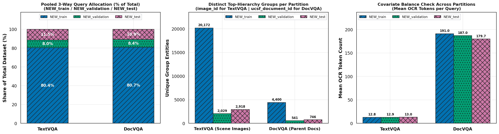

# CrossVQA (`ALT_THREE_SPLITS`) -- Verdict and Technical Specification on Pooled 3-Way Splitting Protocol

> **Document Type:** Formal Methodological Verdict & Pipeline Specification (Pooled Variant)  
> **Phase:** Phase B -- Training Preparation & Data Pipeline Engineering (`DATA_PIPELINE/ALT_THREE_SPLITS/`)  
> **Companion Distribution Audit:** [`DATA_PIPELINE/Verdict on data distribution.md`](../Verdict%20on%20data%20distribution.md) *(shared raw-corpus multiplicity audit; see Section 2 below for pooled & visual-similarity deltas)*  
> **Source Notebooks:**  
> - [`Aggregate_and_NEW_Splits_Pooled.ipynb`](Aggregate_and_NEW_Splits_Pooled.ipynb) (Unified Corpus Pooling, 2-Stage Group-First Partitioning & Manifest Export)  
> - [`Audit_Visual_Similarity_Pooled.ipynb`](Audit_Visual_Similarity_Pooled.ipynb) (64-bit `pHash` Screening & Near-Duplicate Pair Extraction)  
> - [`Check_Leakage_Pooled(local).ipynb`](Check_Leakage_Pooled(local).ipynb) (10-Point Local Zero-Leakage & Integrity Verification)  
> - [`Partition_and_Upload_to_HF.ipynb`](Partition_and_Upload_to_HF.ipynb) (Physical Parquet Shard Routing & Hugging Face Upload)  
> **Target Canonical Repositories (Branch `three-splits`):** [`gamusa/docvqa-canonical@three-splits`](https://huggingface.co/datasets/gamusa/docvqa-canonical/tree/three-splits) & [`gamusa/textvqa-canonical@three-splits`](https://huggingface.co/datasets/gamusa/textvqa-canonical/tree/three-splits)  
> **Total Population:** **84,414 queries** (DocVQA: 44,812 | TextVQA: 39,602) across pooled official `train` and `validation` splits.

---

## 1. Executive Summary & Pooled Splitting Topology

Unlike the baseline protocol in [`../Verdict on ds splitting decision.md`](../Verdict%20on%20ds%20splitting%20decision.md)—which held out official `validation` untouched as `NEW_test`—the `ALT_THREE_SPLITS` protocol **pools official `train` and `validation` into a single unified corpus** before partitioning into `NEW_train`, `NEW_validation`, and `NEW_test`.

This change was motivated by a critical cross-split finding in DocVQA: **523 parent documents (`ucsf_document_id`, 13,798 queries) straddle official `train` and `validation`**, meaning pages from the same multi-page document appear in both official splits. Pooling before group-first splitting resolves that cross-split document leakage and adds a **64-bit perceptual hash (`pHash`) visual similarity gate** to eliminate near-duplicate scans and burst scene photos across splits.

```
                   POOLED OFFICIAL CORPUS (84,414 Queries)
                   ┌─────────────────────────────────────┐
                   │     DocVQA:   44,812 queries        │
                   │     TextVQA:  39,602 queries        │
                   └──────────────────┬──────────────────┘
                                      │
                                      ▼
                GLOBAL TOP-HIERARCHY GROUPING + DSU MERGE
                • DocVQA:  5,687 parent docs (523 bridge docs unified)
                • TextVQA: 25,119 scene images
                • Visual Gate: 85 near-duplicate group pairs merged (d_H <= 3)
                • Outlier Pin: 81 DocVQA mega-docs (|z| > 3.0) -> NEW_train
                                      │
          ┌───────────────────────────┼───────────────────────────┐
          ▼                           ▼                           ▼
 ╔═════════════════╗         ╔═════════════════╗         ╔═════════════════╗
 ║    NEW_train    ║         ║ NEW_validation  ║         ║    NEW_test     ║
 ║ DocVQA:  38,000 ║         ║ DocVQA:   3,141 ║         ║ DocVQA:   3,671 ║
 ║ TextVQA: 32,762 ║         ║ TextVQA:  2,860 ║         ║ TextVQA:  3,980 ║
 ╚═════════════════╝         ╚═════════════════╝         ╚═════════════════╝
```

### The 4 Core Protocol Rules:
1. **Unified Corpus Pooling:** Official `train` and `validation` are pooled prior to splitting so that all pages of a DocVQA parent document (`ucsf_document_id`) are grouped atomically.
2. **Top-Level Group-First Partitioning (Seed `42`):**
   - **DocVQA:** Grouped by `ucsf_document_id` (`5,687` parent documents).
   - **TextVQA:** Grouped by `image_id` (`25,119` scene images).
   - Target shares before DSU quarantine: `~11.0%` `NEW_test` ($N \ge 4,600$), `~8.0%` `NEW_validation` ($N \ge 3,200$), `~80.5%` `NEW_train`.
3. **Heavy-Tail Outlier Pinning ($|z| > 3.0$):** In the final pooled DocVQA aggregate table, **81 mega-documents** (`7,767` queries across `1,885` pages) are deterministically pinned to `NEW_train` so no single massive document distorts validation or test metrics.
4. **Perceptual Near-Duplicate Gate (`pHash`, $d_H \le 3$):** Visually near-duplicate images across splits are detected with 64-bit `pHash` and merged via NetworkX Disjoint Set Union (`DSU`), quarantining **76 of 85** near-duplicate group pairs into `NEW_train` and leaving **0 cross-split visual leaks**.

---

## 2. Distribution & Visual-Similarity Deltas (vs. `Verdict on data distribution.md`)

The underlying raw-corpus multiplicity properties (84,414 queries, dense questions per DocVQA page, strict 1–2 questions per TextVQA scene, heavy-tail DocVQA document sizes) remain as documented in [`../Verdict on data distribution.md`](../Verdict%20on%20data%20distribution.md). The `ALT_THREE_SPLITS` audit surfaces **two additional structural findings**:

### 2.1 Official Train $\leftrightarrow$ Validation Bridge Documents (DocVQA)
Auditing `official_split_origin` across all `5,687` DocVQA parent documents in [`splits/docvqa_document_aggregates_pooled.parquet`](splits/docvqa_document_aggregates_pooled.parquet) reveals:

| `official_split_origin` | Parent Documents (`ucsf_document_id`) | Queries | Share of DocVQA Docs |
|:---|---:|---:|---:|
| `train` only | 4,749 | 29,117 | 83.51% |
| `validation` only | 415 | 1,897 | 7.30% |
| **`train+validation` (Bridge)** | **523** | **13,798** | **9.20%** |
| **Total** | **5,687** | **44,812** | **100.00%** |

In TextVQA, `0` `image_id` entries bridge official `train` and `validation` (`21,953` train + `3,166` val = `25,119` total).

### 2.2 Perceptual Near-Duplicate Audit (`Audit_Visual_Similarity_Pooled.ipynb`)
To catch duplicate scans, minor crop/contrast variants, and camera-burst scene photos that carry distinct `image_id` or `ucsf_document_id` identifiers:
- **Hashes Computed:** `36,156` unique 64-bit DCT `pHash` signatures from `36,451` extracted image records across `73` Parquet shards (`57` DocVQA + `16` TextVQA).
- **Candidate Pairs Screened ($d_H \le 3$):** `18,727,885` DocVQA train-vs-eval pairs (`92` raw image-pair hits) and `99,691,576` TextVQA train-vs-eval pairs (`4` raw image-pair hits).
- **Group Merge Pairs Exported:** **85 unique group pairs** saved to [`splits/visual_near_duplicate_pairs.json`](splits/visual_near_duplicate_pairs.json).
- **Final Quarantine Breakdown (Verified in `Partition_and_Upload_to_HF.ipynb`):**
  - `DOCVQA`: `72` pairs in `NEW_train ↔ NEW_train`, `6` pairs in `NEW_validation ↔ NEW_validation`, `3` pairs in `NEW_test ↔ NEW_test`.
  - `TEXTVQA`: `4` pairs in `NEW_train ↔ NEW_train`.
  - **Total Quarantined to `NEW_train`:** `76 / 85` (`89.4%`).
  - **Cross-Split Visual Leaks ($d_H \le 3$):** **0**.

---

## 3. Realized Final Partition Audit Matrix

Measured directly from [`splits/crossvqa_split_manifest_pooled.parquet`](splits/crossvqa_split_manifest_pooled.parquet) (`84,414` rows) after DSU visual-similarity unification:



| Dataset | Partition | Query Count | % of Total Dataset | Unique Images (`image_id`) | Unique Groups (`group_key`) | Mean / Max Qs per Group | 95% MoE | Mean OCR Tokens | Zero-OCR Queries | Cross-Split Leakage |
|:---|:---|---:|---:|---:|---:|:---:|:---:|---:|---:|:---:|
| **DocVQA** | `NEW_train` | **38,000** | **84.80%** | 9,711 | 4,664 | 8.15 / 762 | $\pm 0.50\%$ | 191.4 | 4 (0.01%) | **0 (Strictly Disjoint)** |
| | `NEW_validation` | **3,141** | **7.01%** | 794 | 421 | 7.46 / 55 | $\pm 1.75\%$ | 178.9 | 0 (0.00%) | **0 (Strictly Disjoint)** |
| | `NEW_test` | **3,671** | **8.19%** | 975 | 602 | 6.10 / 58 | $\pm 1.62\%$ | 178.1 | 0 (0.00%) | **0 (Strictly Disjoint)** |
| **TextVQA** | `NEW_train` | **32,762** | **82.73%** | 20,807 | 20,807 | 1.57 / 2 | $\pm 0.54\%$ | 12.9 | 844 (2.58%) | **0 (Strictly Disjoint)** |
| | `NEW_validation` | **2,860** | **7.22%** | 1,775 | 1,775 | 1.61 / 2 | $\pm 1.83\%$ | 12.7 | 69 (2.41%) | **0 (Strictly Disjoint)** |
| | `NEW_test` | **3,980** | **10.05%** | 2,537 | 2,537 | 1.57 / 2 | $\pm 1.55\%$ | 13.0 | 78 (1.96%) | **0 (Strictly Disjoint)** |

### Notes on Realized Totals:
- **Effect of DSU Quarantine on Split Shares:** Before DSU merging, the initial candidate split in `Aggregate_and_NEW_Splits_Pooled.ipynb` held `80.71% / 8.42% / 10.87%` (DocVQA) and `80.41% / 8.04% / 11.55%` (TextVQA). Re-routing near-duplicate clusters into `NEW_train` shifted the final realized shares to `84.80% / 7.01% / 8.19%` (DocVQA) and `82.73% / 7.22% / 10.05%` (TextVQA), while keeping all 95% MoEs $\le \pm 1.83\%$.
- **Outlier Isolation:** All `81` pinned DocVQA mega-documents (`7,767` queries, max `762` Qs) reside strictly in `NEW_train`; max group size in `NEW_validation` is `55` Qs and in `NEW_test` is `58` Qs.

---

## 4. Verification & Materialized Deliverables

### 4.1 Verification Summary
- **`Check_Leakage_Pooled(local).ipynb`:** **10/10 checks passed** — zero `group_key` overlap, zero `image_id` overlap, all `523` historical bridge documents unified atomically, `84,414` unique `sample_id` / `question_id` conservation, and strict outlier confinement to `NEW_train`.
- **`Partition_and_Upload_to_HF.ipynb`:** Re-serialized and uploaded physical Parquet shards to Hugging Face (`three-splits` branch), verified via remote streaming across all 3 splits of both repositories, and confirmed `0` cross-split visual near-duplicate leaks across all `85` pairs in `visual_near_duplicate_pairs.json`.

### 4.2 Local Manifest & Aggregate Artifacts (`DATA_PIPELINE/ALT_THREE_SPLITS/splits/`)

| File Name | Format | Size | Description |
|:---|:---:|---:|:---|
| [`crossvqa_split_manifest_pooled.parquet`](splits/crossvqa_split_manifest_pooled.parquet) | Parquet | 1,348.3 KB | Full 84,414-row manifest (`sample_id`, `domain_type`, `split`, `NEW_split`, `question_id`, `image_id`, `group_key`, `ocr_token_count`, `dataset`). |
| [`docvqa_document_aggregates_pooled.parquet`](splits/docvqa_document_aggregates_pooled.parquet) | Parquet | 36.9 KB | 5,687 DocVQA parent document aggregates (`ucsf_document_id`, `image_count`, `question_count`, `zero_ocr_count`, `mean_ocr_tokens`, `official_split_origin`, `NEW_split`, `is_pinned_outlier`). |
| [`docvqa_document_aggregates_pooled.csv`](splits/docvqa_document_aggregates_pooled.csv) | CSV | 248.6 KB | Human-readable audit copy of the DocVQA pooled group table. |
| [`textvqa_image_aggregates_pooled.parquet`](splits/textvqa_image_aggregates_pooled.parquet) | Parquet | 267.0 KB | 25,119 TextVQA scene image aggregates (`image_id`, `question_count`, `zero_ocr_count`, `mean_ocr_tokens`, `official_split_origin`, `NEW_split`, `is_pinned_outlier`). |
| [`textvqa_image_aggregates_pooled.csv`](splits/textvqa_image_aggregates_pooled.csv) | CSV | 1,185.0 KB | Human-readable audit copy of the TextVQA pooled group table. |
| [`visual_near_duplicate_pairs.json`](splits/visual_near_duplicate_pairs.json) | JSON | 3.7 KB | 85 visual near-duplicate group merge pairs ($d_H \le 3$). |

### 4.3 Hugging Face Materialized Shards (`three-splits` branch)
- **TextVQA (`gamusa/textvqa-canonical@three-splits`):** `train` (`32,762` rows, `16` shards), `validation` (`2,860` rows, `2` shards), `test` (`3,980` rows, `3` shards).
- **DocVQA (`gamusa/docvqa-canonical@three-splits`):** `train` (`38,000` rows, `20` shards), `validation` (`3,141` rows, `3` shards), `test` (`3,671` rows, `3` shards).
