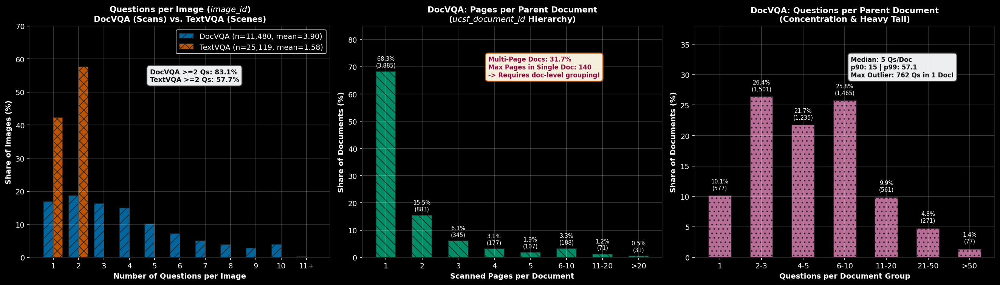

# CrossVQA -- Verdict on Data Distribution & Relational Multiplicity Audit

> **Document Type:** Analytical Report & Protocol Specification  
> **Phase:** Phase B -- Training Preparation & Data Pipeline Engineering (`DATA_PIPELINE/`)  
> **Source Notebook:** [`DATA_PIPELINE/Assess_data_leakage.ipynb`](Assess_data_leakage.ipynb) (Section 1.2 & 1.3)  
> **Target Repositories:** [`gamusa/docvqa-canonical`](https://huggingface.co/datasets/gamusa/docvqa-canonical) & [`gamusa/textvqa-canonical`](https://huggingface.co/datasets/gamusa/textvqa-canonical)  
> **Population Size:** **84,414 total rows** (DocVQA: 44,812 | TextVQA: 39,602) across official `train` and `validation` splits.

---

## 1. Executive Summary & Core Verdict

The full-population columnar audit (84,414 entries) across DocVQA and TextVQA definitively establishes that **multimodal VQA entries are strongly non-independent and identically distributed (non-i.i.d.)**. 

```
DocVQA Hierarchy (Multi-Level):       [ ucsf_document_id ]  (Parent Document, n=5,687)
                                              │
                                              ▼  (1 : M, up to 140 pages, 31.7% multi-page)
                                        [ image_id ]        (Scanned Page, n=11,480)
                                              │
                                              ▼  (1 : M, up to 13 questions, 83.1% >= 2 Qs)
                                       [ question_id ]      (VQA Query Row, n=44,812)

TextVQA Hierarchy (Flat):               [ image_id ]        (Scene Image, n=25,119)
                                              │
                                              ▼  (1 : M, exactly 1 or 2 Qs, 57.7% @ 2 Qs)
                                       [ question_id ]      (VQA Query Row, n=39,602)
```

### Core Verdicts:
1. **Row-Level Splitting (`ShuffleSplit`) is Fatal:** Splitting the original `train` set into an internal `train` and internal `dev` split at the question/row level causes massive **multimodal visual leakage** (over 50% to 90% of `dev` queries will evaluate on images already seen during training).
2. **TextVQA Requires `image_id` Grouping:** Grouping by `image_id` (`GroupShuffleSplit`) eliminates visual contamination for natural scenes.
3. **DocVQA Requires `ucsf_document_id` Grouping (`image_id` is Insufficient):** In DocVQA, **31.7% of documents span multiple pages** (up to 140 pages in a single document). Grouping merely by `image_id` leaks document letterhead, typography, header/footer metadata, and domain style between splits. **All pages of a multi-page document must stay together.**
4. **Extreme Group Outliers Require Seed Verification:** DocVQA group sizes exhibit extreme right tails (up to 762 questions and 140 pages in one document). The splitting protocol must audit total sample counts to avoid skewed dev split ratios.

---

## 2. Empirical Distribution Findings (Section 1.2 & 1.3 Audit)



### 2.1 Multiplicity Distributions Across Benchmarks (Figure Summary)

| Distribution Dimension | Metric / Range | DocVQA (2D Document Scans) | TextVQA (3D Natural Scenes) | Practical Significance |
| :--- | :--- | :--- | :--- | :--- |
| **Questions per Image (`image_id`)** | **Mean** <br> **Median** <br> **Max** <br> **$\ge 2$ Questions (%)** | 3.90 questions/page <br> 3.0 questions/page <br> **13 questions** <br> **83.11%** (9,541 / 11,480) | 1.58 questions/scene <br> 2.0 questions/scene <br> **2 questions** <br> **57.66%** (14,483 / 25,119) | Scanned pages are dense query targets (annotators probe multiple fields per page). TextVQA caps strictly at 2 questions per image. |
| **Pages per Parent Doc (`ucsf_document_id`)** | **Mean** <br> **Median** <br> **p90 / p99** <br> **Max** <br> **$\ge 2$ Pages (%)** | 2.02 pages/doc <br> 1.0 page/doc <br> 4.0 / 15.0 pages <br> **140 pages** <br> **31.69%** (1,802 / 5,687) | *N/A (Flat Single-Image)* <br> *N/A* <br> *N/A* <br> *N/A* <br> *0.00%* | Nearly 1 in 3 DocVQA documents is multi-page. A page-level split leaks identical corporate documents across splits. |
| **Questions per Parent Doc (`ucsf_document_id`)** | **Mean** <br> **Median** <br> **p90 / p99** <br> **Max** <br> **$\ge 2$ Questions (%)** | 7.88 questions/doc <br> 5.0 questions/doc <br> 15.0 / 57.1 questions <br> **762 questions** <br> **89.85%** (5,109 / 5,687) | *N/A (Same as Questions per Image)* | Questions cluster heavily on parent documents. Extreme outliers (e.g., 762 Qs) can distort small development sets if randomly sampled. |

---

### 2.2 Detailed Frequency Breakdown

#### A. Questions per Image (`image_id`)
* **DocVQA:** Distributed across a wide spectrum:
  * 1 Q: 16.9% (1,939 pages)
  * 2 Qs: 18.7% (2,143 pages)
  * 3 Qs: 16.2% (1,863 pages)
  * 4 Qs: 15.0% (1,720 pages)
  * 5 Qs: 10.1% (1,159 pages)
  * 6 Qs: 7.0% (807 pages)
  * 7 Qs: 4.8% (551 pages)
  * 8 Qs: 3.8% (436 pages)
  * 9 Qs: 2.9% (334 pages)
  * 10 Qs: 3.8% (438 pages)
  * 11+ Qs: 0.8% (90 pages, up to 13)
* **TextVQA:** Strictly binary:
  * 1 Q: 42.34% (10,636 scene images)
  * 2 Qs: 57.66% (14,483 scene images)

#### B. DocVQA Pages per Parent Document (`ucsf_document_id`)
* **Single-Page Documents:** 68.31% (3,885 documents)
* **Multi-Page Documents:** 31.69% (1,802 documents)
  * 2 pages: 15.53% (883 documents)
  * 3 pages: 6.07% (345 documents)
  * 4 pages: 3.11% (177 documents)
  * 5 pages: 1.88% (107 documents)
  * 6–10 pages: 3.31% (188 documents)
  * 11–20 pages: 1.25% (71 documents)
  * >20 pages: 0.54% (31 documents, maximum 140 pages in document `qjgn0226`)

#### C. DocVQA Questions per Parent Document (`ucsf_document_id`)
* 1 Q: 10.15% (577 documents)
* 2–3 Qs: 26.39% (1,501 documents)
* 4–5 Qs: 21.72% (1,235 documents)
* 6–10 Qs: 25.76% (1,465 documents)
* 11–20 Qs: 9.86% (561 documents)
* 21–50 Qs: 4.77% (271 documents)
* >50 Qs: 1.35% (77 documents, maximum 762 questions in document `qjgn0226`)

---

### 2.3 Qualitative Proof of Co-Occurring Queries

Real-world exemplars from the audit demonstrate why entries cannot be treated as independent data points:

#### Exemplar 1: Dense Single-Page Queries (DocVQA `ntbf0004_1.png` — `train` split)
* **Image ID:** `ntbf0004_1.png` | **Parent Document:** `ntbf0004` (Page 1) | **Resolution:** $1692 \times 2245$ px
* **Co-Occurring Queries:** **12 questions** asked on this single scan:
  1. `52735`: *"What type of 'Form' is this?"* $\rightarrow$ `Response Code Request Form`
  2. `52736`: *"What is the 'Fax' number mentioned in the form?"* $\rightarrow$ `(910) 741-1672`
  3. `52738`: *"What is RJR Brand?"* $\rightarrow$ `CAMEL`
  4. `52740`: *"What is the 'RJR Program #' number given?"* $\rightarrow$ `600368`
  5. `52747`: *"What is the 'Response Code' mentioned in the form?"* $\rightarrow$ `U80`
  6. `52748`: *"What is the 'Project Name'?"* $\rightarrow$ `1996 Camel Pool Personal Sell Events`
  7. `53089`: *"What is the 'Quantity' mentioned under 'Distribution:'?"* $\rightarrow$ `5,000`
  8. `53093`: *"What is the 'Offer Complete' date mentioned under 'Timing:'?"* $\rightarrow$ `12/31/96`
  9. `53096`: *"Who is the 'Marketing Person Responsible for Project'?"* $\rightarrow$ `Dennis Dillard`
  10. `53101`: *"Who is the 'Production Contact'?"* $\rightarrow$ `Cynthia Stevens`
  11. `53108`: *"Response Code is requested by whom?"* $\rightarrow$ `Lisa Drum`
  12. `53110`: *"What is the 'Agency Name'?"* $\rightarrow$ `Print shop job`

*Every question inspects a different bounding box of the exact same visual document. If any of these 12 questions are split between train and dev, the model tests on memorized visual layout rather than reading comprehension.*

#### Exemplar 2: Multi-Page Document Spread (DocVQA `ucsf_document_id = ffdh0227` — `train` split)
* **Parent Document:** `ffdh0227` | **Pages in Document:** 3 distinct page scans (`ffdh0227_1.png`, `ffdh0227_3.png`, `ffdh0227_4.png`)
* **Questions Across Pages:** **15 total questions** (5 questions on each page):
  * **Page 1:** Title (`R. J. REYNOLDS TOBACCO COMPANY`), Document Date (`September 2, 1993`), Addressee (`C. A. Tucker`)
  * **Page 3:** Budget Subtotal (`$ 41,200`), Grand Total (`$ 1,007,800`)
  * **Page 4:** Preparer Signature (`F. E. Atendido`)

*Even if Page 1 and Page 3 have different `image_id` strings, they share the same letterhead, font styling, institutional context, and author. A split based on `image_id` alone places Page 1 in train and Page 3 in dev, creating severe **cross-page document leakage**.*

---

## 3. Impact on Splitting Protocol (Train $\rightarrow$ Train + Dev, Held-Out Test)

When reserving the official validation split as the final benchmark **`test` set**, the original `train` set must be subdivided into:
* **Internal `train` split:** ~90–95% of training data
* **Internal `dev` (validation) split:** ~5–10% of training data for checkpointing, model selection, and hyperparameter tuning.

### 3.1 Failure of Naive Random Splitting (`ShuffleSplit`)
* **Flawed Approach:** `train_test_split(df, test_size=0.05, random_state=42)`
* **Mathematical Consequence:**
  * For TextVQA, with 57.7% of images having 2 questions, the probability that a dev question's paired question lands in train is $\approx 95\%$. Over **54% of all dev questions** would evaluate on images already seen in training.
  * For DocVQA, with an average of 3.9 questions per page and 7.5 questions per document, **$>85\%$ of dev entries** would evaluate on images or documents seen during training.
* **Resulting Bias:** Falsely inflated internal validation metrics, severe overfitting to specific visual layouts, and a large, unexplained drop in performance when evaluated on the held-out test set.

### 3.2 The Mandatory Group Splitting Protocol

```
┌─────────────────────────┬───────────────────────────┬────────────────────────────────────────────────────────┐
│ Dataset                 │ Mandatory Group Key       │ Grouping Rationale                                     │
├─────────────────────────┼───────────────────────────┼────────────────────────────────────────────────────────┤
│ **TextVQA**             │ `image_id`                │ Single-level flat scenes; guarantees visual isolation. │
│ **DocVQA**              │ `ucsf_document_id`        │ Multi-level document hierarchy; isolates entire        │
│                         │ *(NOT `image_id` alone)*  │ multi-page documents, letterheads, and layout styles.  │
└─────────────────────────┴───────────────────────────┴────────────────────────────────────────────────────────┘
```

### 3.3 Handling Skew & Heavy-Tail Group Outliers
Because DocVQA parent documents reach up to **762 questions** and **140 pages**, an unverified random group split could select one or two massive documents into a 5% dev set ($\approx 1,973$ target questions), causing a single document to monopolize up to 39% of the dev split.

#### Mitigation Rules:
1. **Target Stratification:** Set a fixed seed (e.g., `SEED = 42`) and verify that the resulting split achieves the desired row percentage within $\pm 0.5\%$.
2. **Dominance Guard:** Ensure no single `ucsf_document_id` accounts for $>10\%$ of the internal dev split.
3. **Zero-OCR Balance:** Audit that zero-OCR instances (2.53% in TextVQA) are proportionally represented across both internal splits.

---

## 4. Split Generation Implementation

Below is the verified, publication-grade implementation for Phase B:

```python
import numpy as np
import pandas as pd
from sklearn.model_selection import GroupShuffleSplit

def create_leakage_free_splits(
    df: pd.DataFrame,
    domain: str,
    dev_size: float = 0.05,
    random_state: int = 42
) -> tuple[pd.DataFrame, pd.DataFrame]:
    """
    Partitions the official train split into internal train and dev splits
    enforcing zero visual and document context leakage.
    
    - TextVQA: Groups strictly by image_id
    - DocVQA:  Groups strictly by ucsf_document_id (multi-page parent)
    """
    train_df = df[df["split"] == "train"].copy().reset_index(drop=True)
    
    if domain.lower() == "docvqa":
        group_col = "ucsf_document_id"
    elif domain.lower() == "textvqa":
        group_col = "image_id"
    else:
        raise ValueError(f"Unknown domain: {domain}")
    
    gss = GroupShuffleSplit(n_splits=1, test_size=dev_size, random_state=random_state)
    train_idx, dev_idx = next(gss.split(train_df, groups=train_df[group_col]))
    
    internal_train = train_df.iloc[train_idx].copy()
    internal_dev   = train_df.iloc[dev_idx].copy()
    
    # Verification checks
    train_groups = set(internal_train[group_col])
    dev_groups   = set(internal_dev[group_col])
    assert len(train_groups.intersection(dev_groups)) == 0, "Leakage detected: groups overlap!"
    
    print(f"[{domain}] Split completed successfully (random_state={random_state}):")
    print(f"  Internal Train: {len(internal_train):,} rows ({len(internal_train)/len(train_df):.2%}) | {len(train_groups):,} groups")
    print(f"  Internal Dev:   {len(internal_dev):,} rows ({len(internal_dev)/len(train_df):.2%}) | {len(dev_groups):,} groups")
    
    return internal_train, internal_dev
```

---

## 5. Hugging Face Hosting & Persistence Strategy

Should the re-split dataset be saved on Hugging Face?

| Strategy | Recommended Format | Pros | Cons | Best Use Case |
| :--- | :--- | :--- | :--- | :--- |
| **Strategy A: Full 3-Split Repository** | New HF repo (e.g., `gamusa/crossvqa-docvqa-split`) with `train`, `dev`, `test` partitions. | Dataloader in Google Colab / cloud VMs loads directly: <br>`load_dataset("...", split="dev")`. Zero setup on training nodes. | Duplicates ~15 GB of raw image binaries. | Remote multi-GPU training execution in Phase C. |
| **Strategy B: Split Index Manifest** *(Gold Standard)* | Small Parquet file (`< 2 MB`) containing `sample_id`, `image_id`, `group_id`, `split_crossvqa`. | Zero binary redundancy; reuses canonical repos; 100% deterministic reproducibility for thesis review. | Requires a light join or filter step in the dataloader. | Version-controlled codebase, GitHub repo, thesis appendix. |

### Final Protocol Recommendation:
* **In the Repository:** Commit the deterministic **Split Index Manifest** (`DATA_PIPELINE/splits/crossvqa_split_manifest.parquet`) to guarantee 100% reproducible auditability.
* **On Hugging Face:** Publish the curated 3-split configuration (`train`, `dev`, `test`) so Colab training scripts execute without local filesystem dependencies.

