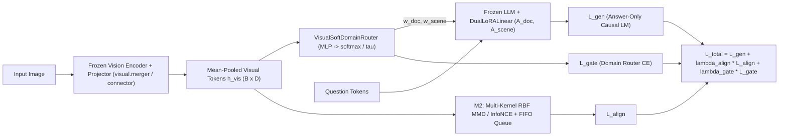

# CrossVQA Phase C — Training Pipeline Architecture & Technical Rationale

> **Document Type:** End-to-End Training Pipeline Specification & Methodological Rationale  
> **Directory Scope:** `TRAIN/src/` & `TRAIN/ALT_THREE_SPLITS/`  
> **Target Canonical Datasets:** `gamusa/docvqa-canonical@three-splits` & `gamusa/textvqa-canonical@three-splits`  
> **Governing Format:** `.agents/rules/prompt-output-to-markdown.md` (`[HHMM]_[DDMMYYYY]_[filename].md` inside `TRAIN/`)  
> **Timestamp:** `08:05` `22/11/2026` (`+07:00`)

---

## 1. Executive Architecture & Directory Layout

The training system cleanly separates **regime-agnostic core ML modules** (`TRAIN/src/`) from **split-specific configurations, CLI entrypoints, Colab runners, and experiment logs** (`TRAIN/ALT_THREE_SPLITS/`). This lets `TRAIN/VALIDATION_AS_TEST/` reuse the exact same model, collator, loss, and trainer implementations without code duplication.

```text
DATA_PIPELINE/ALT_THREE_SPLITS/splits/
├── crossvqa_split_manifest_pooled.parquet   # 84,414-row zero-leakage pooled split manifest
└── textvqa_few_shot_manifest.parquet        # Nested image_id-grouped 1/5/10/25/100% subsets

TRAIN/
├── 0805_22112026_CrossVQA_Training_Pipeline_Documentation.md
├── VLM_Backbones_Technical_Reference.md
├── src/                                     # Shared core library (regime-agnostic)
│   ├── __init__.py
│   ├── dataset.py                           # Local NVMe Parquet / HF streaming + B3 & M1-M3 samplers
│   ├── collator.py                          # Image placeholders, answer-only label masking, EOS, domain IDs
│   ├── models.py                            # Locked backbone loader, selective 4-bit NF4, PEFT/Dual-LoRA
│   ├── adapters.py                          # M1: DualLoRALinear + VisualSoftDomainRouter
│   ├── losses.py                            # M2: MultiKernelRBFMMDLoss, InfoNCE, FIFO Queue, Proxy A-dist
│   ├── augmentations.py                     # M3: CurriculumPseudoDomainTransform (homography/shadow/blur)
│   ├── trainer.py                           # Hardware profiles (L4/T4), CheckpointManager, CrossVQATrainer
│   └── metrics.py                           # ANLS, VQA Accuracy, TG, FR, JSONL predictions, Run Cards
├── tests/
│   └── test_pipeline_smoke.py               # Offline CPU verification suite
└── ALT_THREE_SPLITS/
    ├── README.md
    ├── configs/                             # Locked YAML specifications
    │   ├── backbones.yaml
    │   ├── baselines_B1_B5.yaml
    │   ├── crossvqa_M1_M3.yaml
    │   └── few_shot.yaml
    ├── scripts/                             # Reproducible CLI scripts
    │   ├── _common.py
    │   ├── generate_few_shot_splits.py
    │   ├── run_z0_domain_gap.py
    │   ├── run_baseline.py
    │   ├── run_crossvqa.py
    │   └── build_training_notebooks.py
    ├── notebooks/                           # Ephemeral Colab GPU notebooks (00..05)
    └── runs/                                # Lightweight Git-tracked metrics, logs & UMAP plots only
```

### Key Architectural Principles
1. **Relative Path Discipline:** Every config, script, and notebook resolves paths relative to the repository root (`DATA_PIPELINE/...`, `TRAIN/...`), ensuring portability across Windows workstations and Linux Colab VMs.
2. **Ephemeral Colab Resilience:** Colab VMs provide fast NVMe scratch (`/content/data/`) but can disconnect unexpectedly. Raw Parquet shards are downloaded directly to `/content/data/` (avoiding slow Google Drive FUSE dataset I/O), while trained adapter checkpoints (`*.safetensors`) are synced both to a **private Hugging Face Hub repository** (`gamusa/crossvqa-checkpoints`) and to **personal Google Drive** (`/content/drive/MyDrive/CrossVQA_Checkpoints/ALT_THREE_SPLITS`), excluded from Git via `.gitignore`.
3. **Zero Token Exposure:** Colab notebooks read `HF_TOKEN` (and optional `GH_TOKEN`) via Colab Secrets (`userdata.get`) or masked `getpass.getpass()` prompts at runtime—no secret is ever written to source files, configs, or outputs.

---

## 2. Locked Backbone Hierarchy & Quantization Strategy

### 2.1 Backbone Priority Order (`configs/backbones.yaml` & `src/models.py`)

| Priority | Key | Hugging Face Repo ID | Architecture | Rationale in CrossVQA |
| :---: | :--- | :--- | :--- | :--- |
| **1 (Primary)** | `qwen2_vl_2b` | `Qwen/Qwen2-VL-2B` | 32L ViT + 2×2 Merger + 28L Qwen2 (M-RoPE) | Native dynamic resolution handles the **4.8× resolution gap** (3.7 MP DocVQA vs 0.78 MP TextVQA) without fixed-square distortion or manual tiling. |
| **2 (Secondary 1)** | `smolvlm_base` | `HuggingFaceTB/SmolVLM-Base` | `Idefics3` (27L ViT + Pixel Shuffle + 24L SmolLM2) | Same ~2B parameter class as `Qwen2-VL-2B`; provides a clean **cross-architecture comparison** (M-RoPE dynamic resolution vs `Idefics3` tile splitting). |
| **3 (Secondary 2)** | `smolvlm_500m` | `HuggingFaceTB/SmolVLM-500M-Base` | `Idefics3` (12L ViT + Pixel Shuffle + 32L Llama) | **Fast pilot & scale ablation** backbone for validating M1–M3 training dynamics, loss weights, and 3-seed variance before committing full L4/T4 hours to 2B runs. |

* **Contamination Hygiene:** All three checkpoints are **Base** (pre-trained only, non-`-Instruct`) checkpoints. Evaluating `Z0` first on `NEW_validation` and `NEW_test` establishes the unadapted floor and audits pre-training memorization.

### 2.2 Selective 4-Bit NF4 Quantization
Quantizing early patch/projection weights in the vision encoder degrades legibility of small 6–8 pt characters in DocVQA scans. Therefore, `build_vlm_model_and_processor()` applies 4-bit NF4 QLoRA **only to the LLM decoder**, explicitly exempting the vision encoder and multimodal connector (`llm_int8_skip_modules=["visual", "merger"]` for Qwen2-VL; `["vision_model", "connector"]` for SmolVLM).

### 2.3 Hardware Profiles (`l4_24gb` Primary, `t4_16gb` Fallback)
`resolve_hardware_profile("auto")` inspects CUDA VRAM and compute capability (SM):
* **Preferred (`l4_24gb`, VRAM $\ge$ 20 GB & SM $\ge$ 8.0):** Uses `bfloat16`, `flash_attention_2` (when installed, else `sdpa`), `batch_size=4`, `grad_accum=4` (effective batch `16`), `eval_batch_size=8`, and `max_pixels=1,310,720`.
* **Fallback (`t4_16gb`, 16 GB T4):** Automatically switches to `float16`, `sdpa`, `batch_size=2`, `grad_accum=8` (effective batch `16`), `eval_batch_size=4`, `max_pixels=1,048,576`, and `paged_adamw_8bit` to prevent OOM spikes.

---

## 3. Multimodal Data Processing & Prompt Engineering (`src/dataset.py`, `src/collator.py`)

### 3.1 Dual-Source Ingestion & Domain Pairing
* **NVMe-First Loading:** `load_crossvqa_dataset()` reads `data/{split}-*.parquet` locally from `/content/data/{docvqa,textvqa}` when staged on Colab NVMe, and falls back to streaming `gamusa/*-canonical@three-splits` otherwise.
* **Experiment-Specific Samplers:**
  * `InterleavedCrossVQADataset` (**B3 Joint**): Interleaves DocVQA and TextVQA with `doc_prob=0.5`.
  * `PairedDomainDataset` (**M1–M3**): Emits alternating `(doc_sample, scene_sample)` pairs so every training micro-batch ($B \ge 2$) contains both domains (`domain_id = 0` for `document_text`, `1` for `scene_text`).

### 3.2 Prompt Conditioning, Label Masking & EOS Discipline
* **Track A (Primary — OCR-Free):** Default across all `Z0`, `B1–B5`, `M1–M3`, and few-shot runs (`--include_ocr` omitted). Isolates true visual-reading transfer without external OCR leakage.
* **Track B (Targeted Ablation — Given-OCR):** Enabled via `--include_ocr` on `B1` and `M2` (`max_ocr_tokens=50`), formatting pre-harmonized `ocr_tokens` and `[ymin, xmin, ymax, xmax]` boxes in `[0, 1000]`.
* **Critical Collator Guarantees:**
  1. Model-appropriate visual tokens are always prepended (`apply_chat_template` / `<|vision_start|><|image_pad|><|vision_end|>` for Qwen2-VL; `<image>` for SmolVLM).
  2. During training (`padding_side="right"`), `prompt_inputs` and `full_inputs` (`prompt + " " + target + eos_token`) are aligned so **all padding tokens AND all visual + question prompt tokens are masked to `-100`** in `labels`. The causal LM loss trains strictly on the answer tokens and `eos_token` so greedy generation terminates cleanly.
  3. During evaluation (`padding_side="left"`), batched `model.generate(..., do_sample=False)` slices tokens starting strictly from `input_ids.shape[1]`.

---

## 4. Experimental Matrix & Proposed CrossVQA Method (`Z0`, `B1–B5`, `M1–M3`)

### 4.1 Phase A Diagnostics & Baselines (`run_z0_domain_gap.py`, `run_baseline.py`)
* **Z0 (Zero-Shot + A8/A9):** Evaluates frozen base VLM on `NEW_validation` and `NEW_test`, extracts pooled visual-projector embeddings ($N=2,000$/domain), projects 2D **UMAP** (`A8`), and computes **RKHS MMD** and 5-fold stratified Linear **Proxy $\mathcal{A}$-distance** (`A9`: $\hat{d}_{\mathcal{A}} = 2(1 - 2\epsilon)$) to test **Hypothesis H1**.
* **B1 (Target-Only):** LoRA on TextVQA `train` (reference target bound).
* **B2 (Source-Only):** LoRA on DocVQA `train` (evaluates OOD zero-shot transfer to TextVQA, **H2**).
* **B3 (Joint):** Shared LoRA on interleaved DocVQA + TextVQA (audits negative transfer).
* **B4 (Sequential `Doc -> Text`):** Restores `B2` adapter and fine-tunes on TextVQA (measures catastrophic forgetting $\text{FR}$, **H3**).
* **B5 (Reverse Sequential `Text -> Doc`):** Restores `B1` adapter and fine-tunes on DocVQA (measures directional asymmetry).

### 4.2 Proposed CrossVQA Architecture (`src/adapters.py`, `src/losses.py`, `src/augmentations.py`, `run_crossvqa.py`)



1. **M1 — Dual Domain-Specific LoRA + Visual Soft Gating Router (`adapters.py`):**
   * Standard PEFT `set_adapter()` cannot mix two adapters with different per-sample weights within a single mixed-domain batch. `DualLoRALinear` wraps each LLM attention/MLP projection (`q_proj`, `k_proj`, `v_proj`, `o_proj`, `gate_proj`, `up_proj`, `down_proj`) with parallel branches `(lora_A_doc, lora_B_doc)` and `(lora_A_scene, lora_B_scene)`:
     $$y = W_0 x + w_{\text{doc}}(h_{\text{vis}}) \cdot \frac{\alpha}{r} B_{\text{doc}} A_{\text{doc}}(\text{drop}(x)) + w_{\text{scene}}(h_{\text{vis}}) \cdot \frac{\alpha}{r} B_{\text{scene}} A_{\text{scene}}(\text{drop}(x))$$
   * **Stage 1 (`doc_only`):** Trains $\mathcal{A}_{\text{doc}}$ + router on DocVQA (`forced_domain_id=0`).
   * **Stage 2 (`scene_only_frozen_doc`):** Freezes $\mathcal{A}_{\text{doc}}$ completely to prevent catastrophic forgetting (**RQ3 / H3**) while training $\mathcal{A}_{\text{scene}}$ + router on paired DocVQA + TextVQA data.

2. **M2 — Cross-Domain Feature Alignment (`losses.py`):**
   * Adds $\lambda_{\text{align}} \mathcal{L}_{\text{align}}$ on L2-normalized pooled visual-projector embeddings `pooled_vis`.
   * **Default (`MultiKernelRBFMMDLoss`):** Multi-bandwidth Gaussian RBF MMD ($\sigma \in \{0.5, 1.0, 2.0, 4.0, 8.0\}$) backed by dual-domain **FIFO `FeatureQueue` (`size=256`)**. The queue provides stable distributional statistics on 16–24 GB GPUs where `batch_size` is only 2–4, while gradients flow cleanly through current micro-batch features.
   * **Ablation (`CrossDomainInfoNCELoss`):** Temperature-scaled (`0.07`) contrastive prototype alignment selectable via `--align_type infonce`.

3. **M3 — Curriculum Pseudo-Domain Bridge (`augmentations.py`):**
   * Inserts an intermediate Stage-2 curriculum epoch between Stage 1 (DocVQA) and Stage 3 (TextVQA), applying `CurriculumPseudoDomainTransform` to DocVQA images with linearly ramping severity ($0.2 \rightarrow 1.0$):
     1. Random 3D perspective homography warp (`PIL.Image.Transform.PERSPECTIVE`)
     2. Directional illumination gradient / soft shadow overlay
     3. Mild Gaussian optical blur + JPEG artifact perturbation
   * Bridges the 2D planar $\rightarrow$ 3D perspective gap smoothly (**H2 / H5**).

### 4.3 Few-Shot Scaling Matrix (`generate_few_shot_splits.py`)
To evaluate **Hypothesis H4** cleanly without data leakage, TextVQA `NEW_train` (`32,762` queries across `20,807` unique `image_id`s) is partitioned strictly at the `image_id` level—stratified by OCR token quartiles and questions-per-image—into nested subsets `1% ⊂ 5% ⊂ 10% ⊂ 25% ⊂ 100%` (`DATA_PIPELINE/ALT_THREE_SPLITS/splits/textvqa_few_shot_manifest.parquet`).

---

## 5. Evaluation Metrics, Logging & Colab Workflow

* **Checkpointing & Fault Tolerance (`CheckpointManager`):** Every epoch (and mid-epoch interval if enabled) pushes adapter weights (`dual_lora_weights.safetensors` / PEFT `adapter_model.safetensors`) + `trainer_state.json` to private `gamusa/crossvqa-checkpoints` AND copies them to mounted Google Drive. Passing `--resume_from_hub` automatically recovers interrupted Colab runs.
* **Tracked Metrics (`metrics.py`):** Reports `docvqa_anls`, `textvqa_vqa_accuracy`, cross-metrics (`docvqa_vqa_accuracy`, `textvqa_anls`), `harmonic_mean`, **Transfer Gain** ($\text{TG} = \text{Score}_{\text{Model}} - \text{Score}_{\text{B1}}$), and **Forgetting Rate** ($\text{FR} = \text{ANLS}_{\text{B2}}(\text{Doc}) - \text{ANLS}_{\text{Model}}(\text{Doc})$) into `val_metrics.json`, `run_card.yaml`, and `preds_{split}_{domain}.jsonl` (ready for Phase D bootstrap CIs in `EVALUATION/ALT_THREE_SPLITS/`).

### Colab Execution Order
1. `00_Z0_ZeroShot_and_DomainGap.ipynb` (Frozen `Z0` + UMAP + MMD + Proxy $\mathcal{A}$-distance)
2. `01_B1_B2_SingleDomain_LoRA.ipynb` (Run `B1` and `B2` across seeds `42, 123, 999`)
3. `02_B3_Joint_MultiDomain_LoRA.ipynb`
4. `03_B4_B5_Sequential_Transfer.ipynb` (Restores `B2` / `B1` automatically)
5. `04_M1_M3_CrossVQA_Proposed.ipynb` (Prototype on `smolvlm_500m`, then run `qwen2_vl_2b` & `smolvlm_base`)
6. `05_FewShot_Scaling_Matrix.ipynb` (`1%, 5%, 10%, 25%` across `B1`, `B4`, `M2`)
